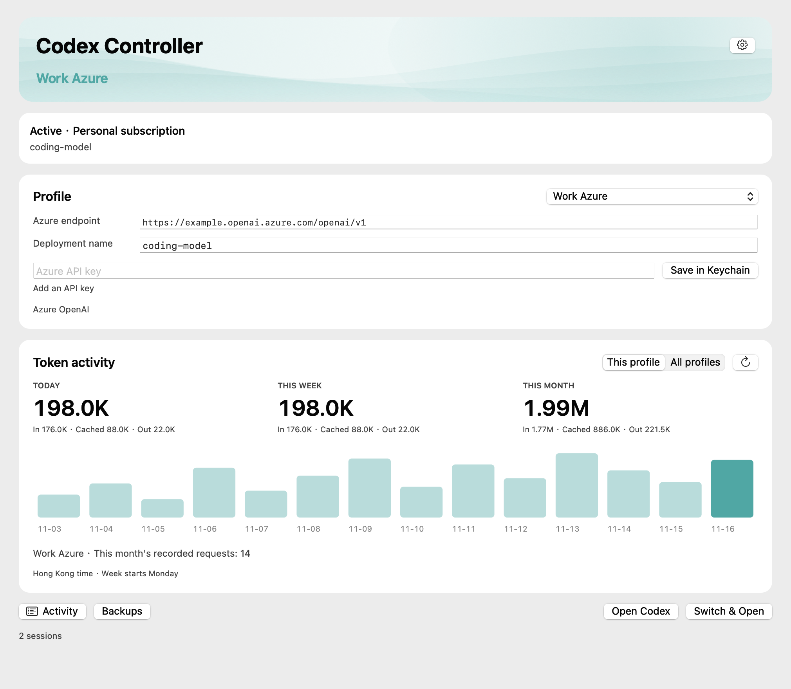

# Codex Controller

A native Mac companion for the original Codex desktop app. Switch between your
ChatGPT subscription and Azure OpenAI profiles, see where your tokens go, and
browse local Codex activity.



*Screenshot uses sample profiles and synthetic usage.*

## Features

- **Profiles:** create Azure connections, rename profiles, edit deployments and
  endpoints, and choose a wave color for each one.
- **Quick switching:** select a profile and choose **Switch & Open**. The original
  Codex app reopens with the selected configuration.
- **Token activity:** daily, weekly and monthly totals, input/cached/output
  breakdowns, and a 14-day chart. View one profile or all profiles together.
- **Activity viewer:** browse recent sessions, tool calls, commands, results,
  assistant messages and recorded reasoning summaries.
- **Native credentials:** one macOS Keychain entry per Azure profile.
- **Gentle color:** a soft moving wave follows the selected profile, respects
  macOS Reduce Motion, and pauses while the app is inactive.
- **Configuration backups:** timestamped backups before switching; existing
  plugins, MCP servers, projects and permissions are preserved.

## Install

Requires **macOS 13 or newer**, Apple's command-line developer tools, and the
original Codex desktop app. No Homebrew, npm or Python packages are needed.

```sh
xcode-select --install  # Skip if the developer tools are already installed.
git clone https://github.com/polykelvin/codex-controller.git
cd codex-controller
zsh setup.sh
```

The setup script builds locally and installs **Codex Controller.app** in
`~/Applications`. It opens the controller without changing your Codex provider.
The build is locally signed, not an Apple-notarized distribution.

Use `zsh setup.sh --no-open` to install without launching. To choose another
installation folder, set `CODEX_CONTROLLER_INSTALL_DIR` before running setup.

## Start using it

1. Start with your personal ChatGPT configuration active in Codex. The controller
   captures those settings the first time you switch.
2. Open the gear button and choose **New Azure profile**. Enter a name, your
   Azure `/openai/v1` endpoint, deployment name and API key. Pick a color and save.
3. Choose the profile in the main window. Its token activity and colors update.
4. Finish any active Codex work, then choose **Switch & Open**.
5. Start a new Codex chat and check its model. Existing chats can retain their
   previous provider. Your Azure deployment must support the Responses API and
   the tool capabilities Codex uses.

**Open Codex** opens the original app without switching. **Activity** opens the
selected profile's local session history. Use the refresh icons for current data.

Azure profile names and colors can change without losing usage history. Delete
unused profiles in Settings; switch away from a configured profile before
deleting it. Personal can be renamed and recolored, and stays available as the
recovery profile.

## What the activity viewer shows

The viewer reads local Codex session records. It shows tool names and arguments,
command execution requests, tool outputs, visible assistant messages, task
status, and reasoning summaries when recorded. It does not expose hidden
reasoning content or manufacture summaries that are absent from the logs.
The latest 200 supported events are shown per session, with a filter by type.

Logs are read locally on demand and are not uploaded. The controller does not
execute activity-viewer contents. Commands and tool outputs can contain private
project information, so review them before sharing your own screenshots.

## Usage coverage

Totals come from local `sessions` and `archived_sessions` records. Response IDs
are deduplicated, and older logs use cumulative-counter differences. Cached
input is part of input; reasoning tokens are not added to output twice.

- Days use Hong Kong time; weeks start Monday.
- These are recorded tokens, not remaining subscription allowance or an Azure
  invoice. Other devices, deleted records and unrecorded activity are not covered.
- New Azure profiles get stable provider IDs for separate attribution. Historical
  `openai` records map to Personal, and the original `company_azure` /
  `codex_controller_azure` records map to the original Company Azure profile.
  Old records cannot reliably distinguish accounts sharing one provider ID.
- Deleted profiles' token records remain visible under **All profiles**.
- Local log formats can change between Codex releases. Unsupported records may
  not appear in the activity viewer or usage totals.

## Storage and recovery

| Item | Location |
| --- | --- |
| Codex settings | `~/.codex/config.toml` (or `$CODEX_HOME/config.toml`) |
| Profiles, usage counter cache, backups | `~/Library/Application Support/Codex Controller/` |
| Azure keys | macOS Keychain, service `com.kelvin.codex-controller.azure` |

The controller never stores API keys in TOML or source files. The original Azure
profile retains its `primary` Keychain account; additional profiles use their
stable IDs. Codex reads a key through the controller's credential-helper mode.

Keep the installed app at a stable path. After moving or rebuilding it, apply a
profile again so Codex uses the correct helper path. Keychain may request access
again after a rebuild. To uninstall, switch to Personal first, then remove the
app and its Keychain entries.

The controller changes the shared user configuration, so new CLI sessions can
inherit the same provider. Managed requirements and other configuration layers
can still affect the active route. Configuration is checked locally; confirm
actual Azure routing using your Azure records.

Backups are private, timestamped TOML files. Use the Personal profile for routine
switching. To recover a full configuration, quit Codex and restore the appropriate
backup over `config.toml`. The controller requests a normal quit and never
force-quits Codex.

## Development

```sh
zsh build.sh
python3 -m unittest discover -s tests -v
```

The app uses AppKit, Security and a Python backend with a bundled TOML parser.
Tests use temporary directories and never change your actual Codex setup or call
a model API. The optional `python3 scripts/make_demo.py` creates a separate demo
app for screenshots using generated data, without reading your account or keys.

An independent community project; not affiliated with OpenAI or Microsoft.

## License

MIT. The bundled Tomli parser retains its own
[MIT license](backend/vendor/TOMLI-LICENSE).
